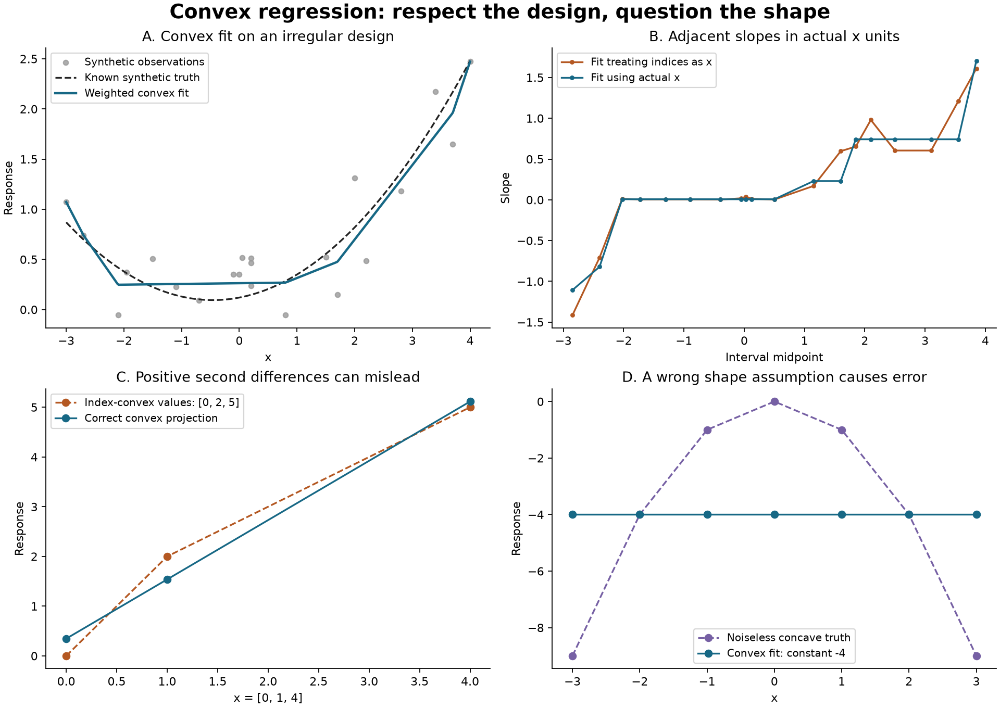

# Convex regression shape audit

Fit a convex function to weighted observations on an irregular one-dimensional design. This project implements a small active-set solver, checks it against exact rational face enumeration and SciPy, and demonstrates why fitting successfully does not validate the shape assumption.

The two practical traps are **using index-based second differences when x is irregular** and **averaging repeated observations without their weights**. A third example shows a perfectly converged convex fit to noiseless concave data: numerical convergence cannot remove model misspecification.

All data are deterministic synthetic examples. No private data, external dataset, or empirical research claims are included.

## Reproduce

Python 3.11 or 3.13:

```bash
python3 -m venv .venv
source .venv/bin/activate
python -m pip install -r requirements-repro.txt
python -m pip install --no-deps .
python -m pip check
python -m pytest -q
python examples/run_demo.py --output results
convex-fit examples/irregular.json
```

Only NumPy is needed for the core. SciPy is an independent test reference, Matplotlib generates the figure, and pytest runs the tests. `requirements-repro.txt` pins the reproduction environment. GitHub Actions runs the installed package, tests, full example, and CLI on both Python versions.

## Problem and geometry

After sorting and combining exactly repeated design values, let $x_1<\cdots<x_n$, $y_i$ be the weighted group mean, and $w_i>0$ the sum of observation weights. Solve

$$\min_f\ \frac12\sum_i w_i(f_i-y_i)^2\quad\text{subject to}\quad
\frac{f_{i+1}-f_i}{x_{i+1}-x_i}\geq\frac{f_i-f_{i-1}}{x_i-x_{i-1}}.$$

Writing these adjacent slope increases as $Df\geq0$ gives a strictly convex quadratic objective and a unique fitted vector. Piecewise-linear interpolation of that vector is convex in exact arithmetic. The function need not be increasing: its **slopes** are nondecreasing. No smoothness penalty or differentiability constraint is imposed.

For repeated observations, replacing a group by its weighted mean and total weight leaves the minimizer unchanged. The original weighted sum of squared errors equals the aggregated sum plus the within-group weighted SSE. That constant is retained in the output. Close but unequal x values are **not** silently merged.

## Solver and numerical checks

With $W=\operatorname{diag}(w)$ and nonnegative dual multipliers $q$, stationarity gives

$$f=y+W^{-1}D^Tq.$$

The dual solve is equivalent to nonnegative least squares:

$$\min_{q\geq0}\|W^{-1/2}D^Tq+W^{1/2}y\|^2.$$

The implementation starts with zero multipliers, adds an inactive coordinate with a positive descent correlation, and solves unrestricted least squares on the passive set. If a proposed multiplier is nonpositive, a boundary step removes a coordinate before continuing. Reduced systems use NumPy least squares rather than forming normal equations. SciPy is not called by this implementation.

To reduce avoidable scale effects, the production path maps x to `[0,1]`, scales weights by their maximum, removes a weighted affine trend from y, and scales the remaining response by `max(1, max(abs(residual)))`. Affine trends lie in the null space of the slope-increase operator, so adding them back preserves the exact projection. Each constraint row is also divided by its weighted Euclidean norm, making columns of the dual NNLS matrix unit norm. These transformations preserve the exact fitted values; finite arithmetic still matters.

The output reports numerical primal feasibility, stationarity, complementarity, primal and dual objectives, their difference, and the constraint matrix condition number. Diagnostics and multipliers are in the **scaled problem's units**. A fit is labeled `converged` only if the active-set stopping criterion and the separate KKT checks pass. Feasibility/stationarity tolerances are 1e-8; complementarity and objective gap use 1e-8 times `max(1, scaled objective)`. The inactive-coordinate threshold is 1e-10.

These are floating-point diagnostics, **not rigorous optimality certificates**. Small negative physical slope increases can remain from rounding; the diagnostic tolerance is not a bound in original slope units. Ill-conditioned inputs can amplify errors. A small residual is not statistical evidence that convexity is appropriate.

The step budget counts reduced least-squares solves. `iteration_limit` and `numerical_failure` return a candidate with diagnostics, and `predict` refuses to use it. Constraint matrices with condition number above 1e10 are rejected. There is no automatic retry that hides failure.

## Experiments



- **Irregular synthetic design:** 22 observations at 20 distinct design points. The true function is `0.12*(x-1)^2 + 0.35*x`; Gaussian perturbations use seed `20261109` and explicitly specified standard deviations. Weights are their inverse variances. A comparison fit treats integer observation indices as x, then maps fitted values back to the actual grid. Its increasing index-slopes need not be increasing physical slopes. RMSE is measured against known synthetic truth on 401 equally spaced points, including endpoints; it is a descriptive example, not a repeated-sampling or real-data performance estimate.
- **Minimal geometry counterexample:** x=`[0,1,4]`, y=`[0,2,5]`, unit weights. The index second difference is positive, but actual slopes are 2 and 1. The correct projection is exactly `[9/26,20/13,133/26]`, with weighted SSE `9/26`.
- **Repeated observations:** x=`[0,1,1,2,3]`, y=`[0,8,0,2,6]`, weights=`[1,1,9,1,1]`. The repeated point has group mean 0.8 and weight 10; its within-group SSE is 57.6. Taking an unweighted group mean would change the problem.
- **Noiseless misspecification:** x=`[-3,-2,-1,0,1,2,3]`, y=`-x²`. The convex projection is the constant -4, with SSE 84. All error comes from the wrong constraint, despite a solved optimization problem.
- **Budget exhaustion:** a deliberately restrictive one-step budget reports `iteration_limit` rather than presenting an unfinished candidate as a fitted model.

`results/summary.json` contains the actual data, fits, diagnostics, exact-reference fractions, and metrics. `results/predictions.json` contains the evaluation grid, truth, and both interpolated fits. Outputs reproduce deterministically with the same stack; last bits and plot metadata can vary across platforms.

Recorded results from this run:

| Diagnostic | Value |
|:--|--:|
| Correct convex fit: synthetic grid RMSE | 0.112553 |
| Index-based comparison: synthetic grid RMSE | 0.123060 |
| Index-based fit: decreasing physical-slope transitions | 5 |
| Correct fit: reduced least-squares solves | 13 |
| Noiseless concave example: design-point RMSE | 3.464102 |
| Repeated-observation example: retained within-group SSE | 57.6 |

These numbers describe the specified examples. The index-based comparison solves a different constraint problem; its slightly larger RMSE here is not a universal ordering of estimators. The central diagnostic is that it violates convexity in the actual design coordinates.

## API and CLI

```python
from convex_shape import fit, predict

model = fit([0, 1, 4], [0, 2, 5], weights=[1, 1, 1])
if model["status"] == "converged":
    print(predict(model, [0, 0.5, 1, 2, 4]))
print(model["diagnostics"])
```

The JSON CLI accepts required `x` and `y`, optional `weights`, `predict_x`, and `max_steps`. Inputs are read without modification. Duplicate/unknown keys, null weight vectors, booleans in numeric arrays, nonfinite values, nonpositive weights, and files above 1 MiB are rejected. Exit codes: 0 for a converged fit, 1 for invalid data/file errors, 2 for command-line usage errors, and 3 for a nonconverged candidate. Predictions are omitted for nonconverged candidates. Extrapolation is always refused.

Limits: 500 observations; 2–80 distinct x values; absolute x at most 1e9; design span at least 1e-12; absolute y at most 1e6; individual weights from 1e-12 to 1e6; raw and aggregated weight ratios at most 1e6; minimum distinct spacing/span at least 1e-7; 1–10,000 reduced solves. Predictions accept up to 10,000 points. These limits bound the scope of this dense educational implementation, not the mathematical problem. The exact reference is limited to nine distinct sorted observations because it enumerates all `2^(n-2)` faces.

## Verification and scope

The 58 tests compare small integer examples against an independent Fraction-based exhaustive face reference and larger irregular weighted examples against SciPy NNLS. Additional checks cover affine equivariance, weight scaling, projection of already-convex data, weighted residual orthogonality, duplicate-group SSE accounting, prediction endpoints, extreme-scale input rejection, solver budgets, and CLI behavior.

The core is a small dense demonstration, not a large-scale solver. It does not provide confidence bands, a convexity hypothesis test, uncertainty from estimated weights, robust loss, outlier protection, adaptive design guarantees, multidimensional convex regression, or extrapolation. Inverse-variance weights are correct only for the specified synthetic experiment; arbitrary positive weights merely define a weighted loss. The interpolated fit is a chosen extension between observations, not an identification guarantee about the true function between them.

## References and provenance

The implementation, synthetic examples, tests, and figure are original to this repository. The underlying optimization and statistical ideas are established:

- [Guntuboyina and Sen, *Nonparametric Shape-restricted Regression*](https://arxiv.org/abs/1709.05707): background on shape-constrained least squares and its statistical scope.
- [SciPy `nnls` documentation](https://docs.scipy.org/doc/scipy/reference/generated/scipy.optimize.nnls.html): the independent numerical reference and nonnegative least-squares problem. No SciPy solver source is copied.

MIT licensed; see `LICENSE`.
